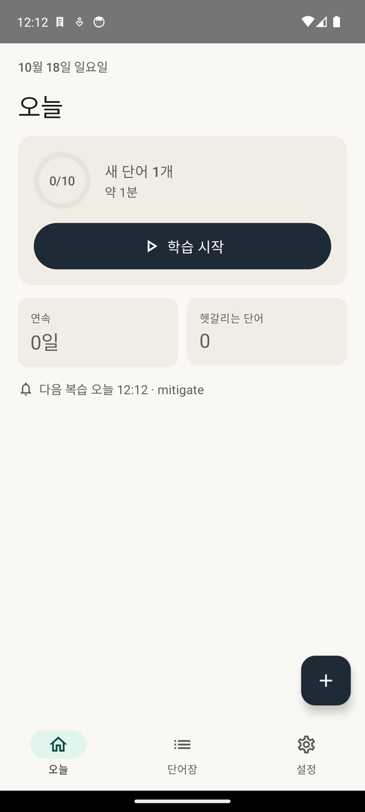
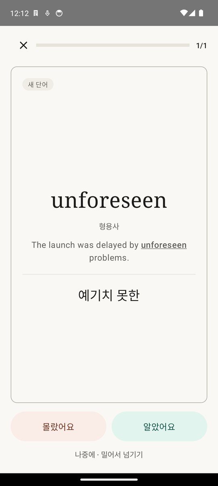
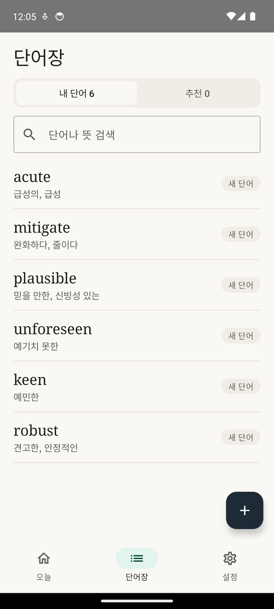
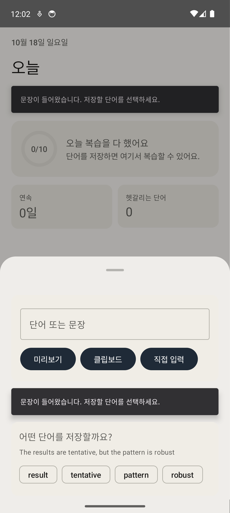
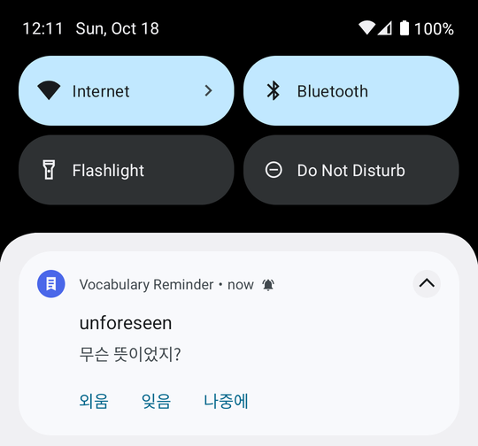
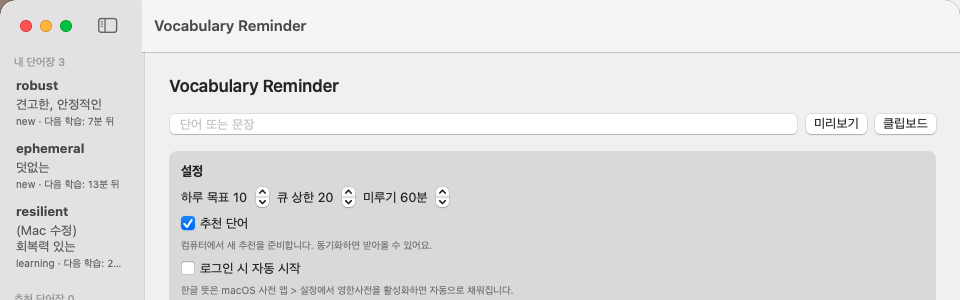

# Vocabulary Reminder

**English** · [한국어](#한국어)

Save the English words you meet while reading on your Android phone or Mac, get the meaning that fits the sentence you found them in, and review them at the right time by notification or in the app. Your own small server keeps every device on one wordbook.

---

## English

The app's interface is in Korean; the screenshots show it as it is.

| Today | Study card | Wordbook |
|---|---|---|
|  |  |  |

| Save from any app | Review notification | Mac menu bar app |
|---|---|---|
|  |  |  |

### Features
- **Save while reading.** On Android, select text and share it (or use the text-selection menu), then pick the word. On the Mac, right-click → Services, copy and press ⌘⌥V, or type in the menu bar app. The sentence is saved with the word.
- **Meanings that fit the sentence.** The server picks the sense the sentence uses ("robust decoding performance" → 견고한, "a robust man" → 튼튼한) with a local LLM (or Claude), using dictionary candidates as hints. Raw dictionary entries are cleaned into short glosses. Meanings you type or choose are never overwritten.
- **Spaced review.** The first review comes 10 minutes after saving and intervals grow as you remember. Answer from the notification (외움 / 잊음 / 나중에) or study in the app: the word and its sentence first, then the meaning, then 몰랐어요 / 알았어요 (or swipe). Both use one schedule.
- **Wordbook.** Search, plain-language status (new, learning, shaky, known, paused), meaning candidates, history and editing per word.
- **Recommendations.** The server suggests words at a sensible level, a few at a time when your reviews are not piling up.
- **Your devices, one wordbook.** Phone and Mac sync through your own server and keep working offline. Words saved twice on two devices fold into one card that keeps the furthest progress.
- **Private by design.** No accounts and no third-party cloud. Each device connects with a one-time code and gets its own token; the apps contain no server address or secret. Daily backups can be copied to folders such as Google Drive and iCloud Drive.
- **Updates.** The Android app updates itself from your server.

### Install (Release)
1. **Set up the sync server** on an always-on Mac (Node 22, launchd, Tailscale Funnel for a stable HTTPS address; nothing to install on the phone). Follow [Operations → Sync Server](docs/operations.md#sync-server-mac-studio), then make a code for the first device with `node server/tools/pair_code.mjs`.
2. **Android**: download `VocabReminder-Android-<version>.apk` from [Releases](https://github.com/ksemperor97/vocab-reminder/releases), open it on the phone and allow installing from that source.
3. **Mac**: download `VocabReminder-macOS-<version>.zip`, unzip it and move `VocabReminder.app` to `/Applications`. It is not notarized, so the first time use **System Settings → Privacy & Security → Open Anyway**, or run `xattr -dr com.apple.quarantine /Applications/VocabReminder.app`.
4. **Connect** each app: tap 서버에 연결 and enter the server address and the 6-digit code, or scan the QR code from a connected Mac (Settings → 다른 기기 연결). Codes last 10 minutes and work once.
5. The illustrated [user guide](docs/user-guide/index.html) (also in each release as `VocabReminder-UserGuide.zip`) walks through daily use.

### Requirements
- Android 8.0 or later; macOS 14 or later.
- A Mac that stays on for the sync server, with Node 22 and a Tailscale account (free) for Funnel.
- For sentence-based meanings: LM Studio with a local model (tested with Qwen) on the server Mac, or an Anthropic API key. Without either, words get dictionary meanings.

### Build from source
```sh
# Sync server
cd server && npm install && npm test && npm start

# Android (Android SDK + JDK 17)
cd android/VocabReminderAndroid && ./gradlew :app:assembleDebug

# Mac (Xcode or Command Line Tools)
cd mac/VocabReminderMac && ./swift.sh test && ./package_app.sh && open VocabReminder.app

# Release apps with no server address or token embedded
SYNC_RELEASE_PUBLIC=1 npm run sync:release
```
Release signing, the real end-to-end run (emulator + Mac app UI tests), backups and moving the server are described in [docs/operations.md](docs/operations.md).

### How it works / Data sources
- **Server (Node + SQLite)** is the authority for merging, folding duplicates, recommendations and meanings. Cards merge per field group (content and schedule each have their own clock), so an edit on one device and a review on another both survive. The rules are shared by the server (JS), Android (Kotlin) and Mac (Swift) and pinned by test vectors in `shared/test-vectors/`.
- **Clients** keep everything in SQLite and upload only changed rows; they work offline and catch up later.
- **Meanings**: the macOS dictionary on the Mac (looked up on the device, not redistributed), a project-authored catalogue on the server, and the sentence-based pick from a local LLM or Claude.
- **Recommendations** are ranked by word frequency from SUBTLEX-US.

### Credits
- Word frequencies: [subtlex-word-frequencies](https://github.com/words/subtlex-word-frequencies) (ISC), from SUBTLEX-US.
- Curated recommendation meanings are written for this project.
- Tailscale, LM Studio, Qwen and Claude are products of their respective owners; this project is not affiliated with them.

---

## 한국어

책이나 웹을 읽다가 만난 영어 단어를 Android 폰이나 Mac에서 저장하면, 그 단어를 만난 문장에 맞는 뜻을 찾아 주고 알맞은 때에 알림이나 앱 안 학습으로 복습하게 해 줍니다. 직접 운영하는 작은 서버가 모든 기기의 단어장을 하나로 맞춥니다.

| 오늘 | 학습 카드 | 단어장 |
|---|---|---|
|  |  |  |

| 다른 앱에서 저장 | 복습 알림 | Mac 메뉴 막대 앱 |
|---|---|---|
|  |  |  |

### 기능
- **읽으면서 저장.** Android에서는 글을 선택해 공유하거나 텍스트 선택 메뉴를 쓴 뒤 단어를 고릅니다. Mac에서는 오른쪽 클릭 → 서비스, 복사 후 ⌘⌥V, 또는 메뉴 막대 앱에 직접 입력합니다. 단어가 있던 문장도 함께 저장됩니다.
- **문장에 맞는 뜻.** 서버가 사전의 뜻 후보를 참고해, 그 문장에서 쓰인 뜻을 로컬 LLM(또는 Claude)으로 고릅니다("robust decoding performance" → 견고한, "a robust man" → 튼튼한). 사전 원문은 짧은 뜻으로 정리하고, 직접 쓰거나 고른 뜻은 덮어쓰지 않습니다.
- **간격 반복 복습.** 저장하고 10분 뒤 첫 복습이 오고, 기억할수록 간격이 늘어납니다. 알림에서 외움 / 잊음 / 나중에로 답하거나, 앱에서 단어와 문장을 먼저 보고 뜻을 확인한 뒤 몰랐어요 / 알았어요로 답합니다(밀어서 넘기기도 됨). 둘은 같은 일정을 씁니다.
- **단어장.** 검색, 쉬운 상태 표시(새 단어, 배우는 중, 헷갈림, 익힘, 보류), 단어별 뜻 후보와 기록, 수정.
- **추천 단어.** 복습이 밀려 있지 않을 때, 서버가 수준에 맞는 단어를 조금씩 골라 줍니다.
- **여러 기기, 하나의 단어장.** 폰과 Mac은 내 서버로 동기화되고 오프라인에서도 동작합니다. 두 기기에서 같은 단어를 저장하면 진도가 가장 앞선 카드 하나로 합쳐집니다.
- **개인정보 중심.** 계정도 외부 클라우드도 없습니다. 기기마다 일회용 코드로 연결해 각자 토큰을 받고, 앱 안에는 서버 주소나 비밀값이 없습니다. 매일 백업을 Google Drive나 iCloud Drive 같은 폴더에도 복사할 수 있습니다.
- **업데이트.** Android 앱은 내 서버에서 스스로 업데이트합니다.

### 설치 (Release)
1. **동기화 서버 준비**: 항상 켜 두는 Mac에 설치합니다(Node 22, launchd, 고정 HTTPS 주소용 Tailscale Funnel. 폰에는 아무것도 설치하지 않음). [운영 문서 → Sync Server](docs/operations.md#sync-server-mac-studio)를 따르고, 첫 기기용 코드는 `node server/tools/pair_code.mjs`로 만듭니다.
2. **Android**: [Releases](https://github.com/ksemperor97/vocab-reminder/releases)에서 `VocabReminder-Android-<버전>.apk`를 받아 폰에서 열고 그 출처의 설치를 허용합니다.
3. **Mac**: `VocabReminder-macOS-<버전>.zip`을 받아 압축을 풀고 `VocabReminder.app`을 응용 프로그램 폴더로 옮깁니다. Apple 공증이 없어서 처음에는 **시스템 설정 → 개인정보 보호 및 보안 → 그래도 열기** 버튼을 누르거나 `xattr -dr com.apple.quarantine /Applications/VocabReminder.app`을 실행합니다.
4. **연결**: 각 앱에서 서버에 연결을 누르고 서버 주소와 6자리 코드를 입력하거나, 연결된 Mac(설정 → 다른 기기 연결)의 QR 코드를 찍습니다. 코드는 10분 동안 한 번만 쓸 수 있습니다.
5. 매일 쓰는 방법은 사진이 들어간 [사용 안내](docs/user-guide/index.html)에 있습니다(릴리스의 `VocabReminder-UserGuide.zip`에도 들어 있음).

### 요구 사항
- Android 8.0 이상, macOS 14 이상.
- 동기화 서버를 둘 항상 켜진 Mac(Node 22)과 Funnel용 Tailscale 계정(무료).
- 문장 기반 뜻: 서버 Mac의 LM Studio와 로컬 모델(Qwen으로 확인), 또는 Anthropic API 키. 둘 다 없으면 사전 뜻을 씁니다.

### 소스에서 빌드
```sh
# 동기화 서버
cd server && npm install && npm test && npm start

# Android (Android SDK + JDK 17)
cd android/VocabReminderAndroid && ./gradlew :app:assembleDebug

# Mac (Xcode 또는 Command Line Tools)
cd mac/VocabReminderMac && ./swift.sh test && ./package_app.sh && open VocabReminder.app

# 서버 주소와 토큰이 들어가지 않은 릴리스 앱
SYNC_RELEASE_PUBLIC=1 npm run sync:release
```
릴리스 서명, 실제 실행 E2E(에뮬레이터 + Mac 앱 UI 테스트), 백업, 서버 이전은 [docs/operations.md](docs/operations.md)에 있습니다.

### 동작 방식 / 데이터 출처
- **서버(Node + SQLite)** 가 병합, 중복 단어 합치기, 추천, 뜻 고르기를 맡습니다. 카드는 내용과 복습 일정이 각자 시계를 가진 필드 그룹 단위로 병합되어, 한 기기의 수정과 다른 기기의 복습이 모두 살아남습니다. 이 규칙은 서버(JS), Android(Kotlin), Mac(Swift)이 함께 쓰고 `shared/test-vectors/`의 테스트 데이터로 고정합니다.
- **앱**은 모든 데이터를 SQLite에 두고 바뀐 행만 올립니다. 오프라인에서도 동작하고 나중에 따라잡습니다.
- **뜻**: Mac의 macOS 사전(기기에서 조회만 하고 다시 배포하지 않음), 서버의 프로젝트 자체 목록, 로컬 LLM이나 Claude의 문장 기반 선택.
- **추천 단어**는 SUBTLEX-US 단어 빈도로 순위를 매깁니다.

### 출처
- 단어 빈도: [subtlex-word-frequencies](https://github.com/words/subtlex-word-frequencies) (ISC), SUBTLEX-US 기반.
- 추천 단어의 뜻은 이 프로젝트에서 직접 작성했습니다.
- Tailscale, LM Studio, Qwen, Claude는 각 소유자의 제품이며, 이 프로젝트는 그들과 관련이 없습니다.
